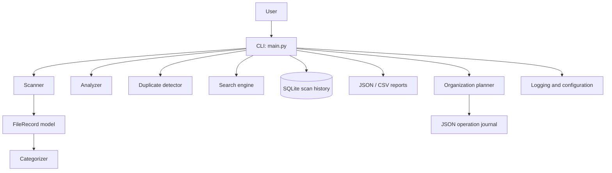

# FileSense Architecture

This document describes the internal structure of FileSense, the responsibilities of its modules, and the flow of data through the application.

## 1. Architectural overview

FileSense follows a modular, command-line-oriented architecture. The CLI coordinates independent modules for filesystem scanning, metadata analysis, duplicate detection, search, persistence, reporting, and file organization.

The application uses Python's standard library for runtime functionality. SQLite provides local scan-history persistence, while JSON and CSV are used for reports and the organization-operation journal.



The diagram shows the main responsibilities and relationships. The CLI is the orchestration layer; individual modules contain the implementation for their respective tasks.

## 2. Project structure

```text
FileSense/
├── filesense/
│   ├── __init__.py
│   ├── analyzer.py
│   ├── categorizer.py
│   ├── config.py
│   ├── database.py
│   ├── duplicates.py
│   ├── logging_config.py
│   ├── models.py
│   ├── organizer.py
│   ├── reports.py
│   ├── scanner.py
│   └── search.py
├── tests/
├── reports/
├── .gitignore
├── LICENSE
├── main.py
├── README.md
└── requirements-dev.txt
```

### Entry point

**`main.py`**

- Defines the command-line interface using `argparse`.
- Creates subcommands and parses user arguments.
- Coordinates scanning, analysis, search, duplicate detection, history, reports, organization, and rollback.
- Configures application logging.
- Handles expected filesystem and validation errors at the CLI boundary.

### Core package

| Module | Responsibility |
|---|---|
| `scanner.py` | Recursively iterates through a directory and collects accessible file records. |
| `models.py` | Defines the immutable `FileRecord` data model and metadata serialization. |
| `categorizer.py` | Maps file extensions to human-readable categories. |
| `analyzer.py` | Calculates storage summaries, formats byte values, and identifies largest files. |
| `duplicates.py` | Finds identical file contents using size grouping and chunked SHA-256 hashing. |
| `search.py` | Applies combined metadata filters and sorting to scanned records. |
| `database.py` | Creates and accesses the SQLite database used for scan history. |
| `organizer.py` | Builds move previews, applies confirmed operations, journals moves, and rolls them back. |
| `reports.py` | Exports scan records and summaries to JSON and CSV. |
| `config.py` | Loads and validates environment-based runtime configuration. |
| `logging_config.py` | Configures console and file logging. |

## 3. Core data model

The central data structure is `FileRecord`, a frozen, slotted dataclass representing one file discovered during a scan.

It stores:

- `name`: file name.
- `path`: resolved file path.
- `extension`: normalized extension, or a marker for files without an extension.
- `size_bytes`: file size in bytes.
- `modified_at`: modification timestamp.
- `category`: category determined from the extension.

The scanner creates these records from filesystem metadata. Analysis, duplicate detection, search, persistence, and reporting consume the records rather than independently re-reading metadata.

This shared model keeps data consistent between modules and makes the core logic easier to test.

## 4. Main data flows

### 4.1 Scan and analysis

1. The user runs the `scan` command.
2. `main.py` calls `scan_directory()` in `scanner.py`.
3. The scanner walks the directory tree without following directory symlinks.
4. Each accessible file is converted into a `FileRecord`.
5. Inaccessible paths are collected as non-fatal warnings.
6. `analyzer.py` calculates file counts and storage summaries.
7. `database.py` stores the scan summary and file metadata snapshot.
8. If requested, `reports.py` writes JSON or CSV output.

The scan itself does not move, rename, or delete files.

### 4.2 Duplicate detection

1. The CLI scans the selected directory.
2. `duplicates.py` groups candidate records by file size.
3. Files in groups with multiple candidates are read in fixed-size chunks.
4. Each candidate receives a SHA-256 digest.
5. Matching digests are returned as duplicate groups.
6. Read or hashing errors are reported separately.

Grouping by size avoids hashing files that cannot have identical contents. Chunked reading avoids loading an entire large file into memory at once.

### 4.3 Search

1. The CLI converts search arguments into a `SearchCriteria` object.
2. The criteria are validated.
3. The scanner collects records for the selected directory.
4. `search_files()` applies the requested filters.
5. Matching records are sorted using the selected sort key.
6. The scan and its metadata are saved to history.
7. Results are displayed in the terminal.

Search operates on scanned metadata and does not modify files.

### 4.4 Scan-history persistence

The database layer uses Python's built-in `sqlite3` module.

The database contains two primary tables:

- **`scans`** stores one row per scan, including the root directory, timestamp, file count, total bytes, serialized summary, and warning count.
- **`scan_files`** stores the file metadata snapshot associated with each scan.

Each file snapshot references its scan through `scan_id`. An index on this field supports scan-specific metadata access. Database connections are closed after operations, and writes use SQLite transaction handling.

The default database location is `instance/filesense.db`. It is local runtime data and is excluded from version control.

### 4.5 Organization and rollback

Organization is intentionally separated into planning and execution.

**Planning phase**

1. The scanner collects file records.
2. `build_organization_plan()` calculates proposed source and destination paths.
3. Category folders are used by default; optional extension rules can override the destination folder.
4. Unsafe folder names, paths outside the destination tree, existing destinations, duplicate destinations, and files already inside the destination tree are rejected or skipped as appropriate.
5. The CLI prints the plan without moving files.

**Execution phase**

1. The user must request `--apply`.
2. The CLI displays a confirmation prompt.
3. The user must type `yes`.
4. `apply_organization_plan()` validates the plan and existing operation journal.
5. Files are moved and the operation is recorded in `.filesense-history.json`.
6. If a move or journal write fails, the implementation attempts to reverse completed moves.

**Rollback phase**

1. The user selects the latest operation or supplies an operation ID.
2. The journal entry is validated.
3. The implementation checks that moved files exist and original paths are unoccupied.
4. Files are restored in reverse order.
5. The journal is updated to mark the operation as rolled back.

Rollback does not intentionally overwrite existing files. As with any filesystem operation, an unexpected operating-system failure can still require manual inspection; the journal and error handling are designed to make recovery safer.

## 5. Safety boundaries

FileSense uses different safety boundaries for analysis and organization.

| Operation | Reads file metadata/content | Changes file locations | Requires confirmation |
|---|---:|---:|---:|
| Scan | Yes | No | No |
| Largest-file analysis | Yes | No | No |
| Duplicate detection | Yes, for hashing candidates | No | No |
| Search | Metadata | No | No |
| History | Local database | No | No |
| Report export | Scanned metadata | Writes report output only | No |
| Organization preview | Metadata | No | No |
| Apply organization plan | Moves selected files | Yes | Yes |
| Rollback | Uses operation journal | Restores moved files | Explicit rollback command |

The organizer validates source and destination paths, rejects collisions, records operations, and provides a rollback path. FileSense does not include an automatic file-deletion feature.

## 6. Configuration and logging

Runtime configuration is centralized in `config.py` and loaded from environment variables:

- `FILESENSE_DATABASE` selects the SQLite database path.
- `FILESENSE_LOG` selects the log file path.
- `FILESENSE_LOG_LEVEL` selects the logging level.

Defaults are used when variables are not supplied. Unsupported logging levels are rejected during configuration validation.

`logging_config.py` configures the application logger with console and file handlers. The organizer uses this logger to record move and rollback activity.

## 7. Testing strategy

The test suite is organized around module responsibilities:

- Scanner and categorization behavior.
- Storage analysis.
- Duplicate grouping and hashing.
- Search filters and sorting.
- SQLite persistence and history.
- JSON and CSV report generation.
- Configuration and logging.
- Organization planning, confirmation, journaling, and rollback.
- CLI integration for organization workflows.

Tests use temporary directories and controlled test data so filesystem operations can be checked without depending on a user's personal files.

Run the suite from the repository root:

```bash
python -m pytest -v
```

Additional quality checks:

```bash
python -m ruff check .
python -m ruff format --check .
python -m pytest --cov=filesense --cov-report=term-missing
```

## 8. Design decisions

- **Standard-library runtime:** keeps installation simple and avoids unnecessary runtime dependencies.
- **Shared immutable records:** gives analysis modules a consistent representation of file metadata.
- **Size-first duplicate detection:** reduces the number of files that need to be hashed.
- **Chunked hashing:** bounds memory use during duplicate detection.
- **SQLite snapshots:** keeps scan history local and queryable without a separate database service.
- **Preview-first organization:** separates planning from file-changing actions.
- **Explicit confirmation and journaling:** makes organization deliberate and supports rollback.
- **Modular responsibilities:** keeps CLI orchestration separate from the underlying business logic.

---

FileSense is an evolving project. This document describes the current implementation and should be updated when the architecture or module responsibilities change.
